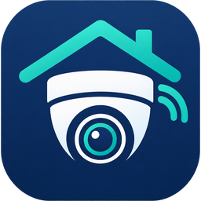

# Hikvision Bridge



Local Home Assistant integration for Hikvision cameras and recorders (NVR/DVR) over ISAPI,
with optional Hik-Connect cloud status. Events arrive by push; nothing is polled once per second.

The user interface is available in English and German.

## What you get

| Area | Entities / functions |
| --- | --- |
| Detections | Binary sensor per channel and detection kind (motion, line crossing, intrusion, region entrance/exit, tamper, video loss, …); optional person/vehicle sensors |
| Event entities | One per channel, fires on every smart detection (good for automations that must not miss repeated triggers) |
| Switches | Detections on/off (only the `enabled` flag is written back, everything else stays byte-identical); alarm outputs |
| Image settings | Per channel, only what the camera offers: day/night mode, supplement light (IR/white light) and its brightness, brightness, contrast, saturation, sharpness, WDR (enabled by default); BLC, HLC, noise reduction, defog, white balance, exposure, shutter, gain limit, power line frequency, flip, stabilization, lens correction (disabled by default). A setting that is not part of the active mode (e.g. white light brightness while in IR mode) is unavailable. Writes change one element of one section and are read back |
| Cameras | Main/sub stream per channel, snapshots |
| Recorder | One HA device per channel below the recorder, channel connected, storage status/free/capacity, alarm inputs |
| Health | Event connection, event delay, repairs for misconfigured devices (see below) |
| Hik-Connect (optional) | Cloud connection per device, stream-encryption status, connection change events, door opening for intercoms (unverified, see limits) |
| Actions | `add_center_links`, `isapi_request` (read-only unless confirmed), `ptz_move`, `ptz_preset`, `set_notification_host` |

## Installation

### HACS (recommended)

1. HACS → three-dot menu → **Custom repositories** → add `https://github.com/yannik2480/hikvision_bridge`, category **Integration**.
2. Install **Hikvision Bridge**, restart Home Assistant.
3. **Settings → Devices & services → Add integration → Hikvision Bridge**.

### Manual

Copy `custom_components/hikvision_bridge` into your `config/custom_components/` folder and restart.

Requires Home Assistant 2026.9 or newer.

## Setup

Choose **Camera or recorder in the local network** or **Hik-Connect account**.

### Devices

* **Connection**: *Automatic* tries HTTPS first and uses HTTP only if HTTPS cannot connect at all.
  An authentication error is never retried with the other scheme. You can also force HTTP or HTTPS
  and disable certificate verification for self-signed certificates.
* **Credentials per device**: every device has its own username and password. A recorder and its
  cameras may use different users.
* **Each device once**: entries are keyed by serial number, not by address. A changed IP is fixed with
  **Reconfigure**; the integration refuses if the new address belongs to a different device.

### Cameras behind a recorder

Cameras connected to a recorder appear as channel devices of the recorder. If a camera is also
reachable directly (for example the recorder's PoE subnet is routed), add a **Direct camera connection**
to the recorder entry (*Add* on the recorder entry). It has its own address and credentials and is
used for the live stream, image settings and detection switches, and optionally for detections. The
channel device is then listed under its connection. When you add such a camera as a normal device,
the integration notices it is already a recorder channel and offers to link it instead.

### Hik-Connect

Hik-Connect has no official third-party interface. The integration only logs in, reads the device
list and status every 30 seconds, and stores the password in Home Assistant. If Hik-Connect asks for
a verification code, the flow shows it. Cloud devices are shown as their own devices, placed below the
matching local device when there is one.

## Recommended device settings

The integration reads, it does not reconfigure your devices on its own. Repairs point you to settings
that keep events from arriving; fixes that change the device always ask first.

1. **Notify surveillance center** must be ticked in the linkage of each detection you want in Home
   Assistant (*Event → … → Linkage Method*). Without it the device detects but never reports.
   The repair *“… is not reported”* or the action `add_center_links` can tick it for you (preview first).
2. **Draw the line or area**: a line crossing or intrusion detection without a drawn line/area never triggers.
3. **Hik-Connect stream encryption** (*Network → Platform Access*): when on, Home Assistant cannot
   decode the recorder's stream (snapshots and events still work). Switch it off or use a direct camera connection.
4. **Recorder motion target filter**: some recorders report motion only for people/vehicles. The repair names the filter.
5. **Time**: configure NTP; event times are corrected, recordings are not.
6. **Digest authentication** (*System → Security → Authentication*) or HTTPS, so passwords are not sent in clear text.

### User rights

Use a dedicated user per device (an *Operator* is enough):

| Function | Remote right needed |
| --- | --- |
| Discovery, sensors, events | Remote: Parameters settings (read), Notify surveillance center / alarm |
| Live view, snapshots | Remote: Live view |
| Detection switches, image settings, alarm outputs, repairs that tick linkage | Remote: Parameters settings |
| PTZ actions | Remote: PTZ control |
| Restart button (disabled by default) | Remote: Shutdown/Reboot |

## Troubleshooting

* **“Login locked”**: Hikvision devices lock a user/IP after several failed logins. The integration
  stops at the first rejection, never retries, and waits for the lock to expire. Correct the password via the reauthentication notice.
* **No events**: check the *Event connection* sensor and the repairs; most often the linkage
  *Notify surveillance center* is missing or no area is drawn.
* **Camera shows no video, snapshots work**: Hik-Connect stream encryption (see above).
* **Events late**: compare the *Event delay* sensor; large values usually mean a wrong device clock.
* **Diagnostics**: *Download diagnostics* on the entry. Passwords, usernames, serial numbers, MAC
  addresses, IP addresses, webhook ids and cloud sessions are removed.

## Known limits

* Hik-Connect is undocumented and may change; errors show as *cloud request failed* rather than crashes.
* Door opening for intercoms through Hik-Connect is implemented but not yet verified on real hardware.
* Session login (cookie based) is not implemented; Digest and Basic authentication are.
* Holiday schedules are not exposed.

## Development

Home Assistant does not run on Windows, so tests run in a container:

```sh
sh scripts/test.sh
```

Tests use simulated devices; no test talks to real hardware.
