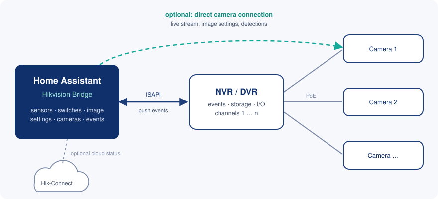

<p align="center">
  
</p>

<h1 align="center">Hikvision Bridge</h1>

<p align="center">
  Local Home Assistant integration for Hikvision cameras and recorders (NVR/DVR) over ISAPI.<br>
  Push events, live streams, detection switches and image settings, with optional Hik-Connect cloud status.
</p>

<p align="center">
  <a href="https://hacs.xyz"></a>
  
  
  
</p>

<p align="center">
  <a href="https://my.home-assistant.io/redirect/hacs_repository/?owner=yannik2480&repository=hikvision_bridge&category=integration"></a>
  <a href="https://my.home-assistant.io/redirect/config_flow_start/?domain=hikvision_bridge"></a>
</p>

---

## Why

* **Everything stays local.** Events arrive by push over the device's alert stream; nothing is polled once per second.
* **Your devices are not reconfigured behind your back.** The integration reads; every change is either an entity you switch or a repair that asks first.
* **Recorders and cameras together.** Cameras behind an NVR become channel devices, and can additionally be reached directly for live view and image settings.
* **Careful with logins.** Hikvision locks users after failed logins, so a rejected password is never retried in a loop.

<p align="center">
  
</p>

## What you get

| Area | Entities / functions |
| --- | --- |
| Detections | Binary sensor per channel and detection kind (motion, line crossing, intrusion, region entrance/exit, tamper, video loss, scene change, defocus, audio exception); optional person/vehicle sensors |
| Event entities | One per channel, fires on every smart detection (good for automations that must not miss repeated triggers) |
| Switches | Detections on/off including video loss on recorders (only the `enabled` flag is written back, everything else stays byte-identical); alarm outputs; arm/disarm alarm inputs |
| Image settings | Day/night, supplement light, colour, WDR and more per channel (see below) |
| Deterrence and audio | Strobe light duration and frequency, siren sound, volume and repeats, speaker and microphone volume (cameras that have them) |
| Cameras | Main/sub stream per channel, snapshots, codec and resolution as attributes |
| Recorder | One HA device per channel below the recorder, channel connected, recording per channel, storage status/free/capacity, alarm inputs |
| Health | Event connection, event delay, stream encryption, IP address, repairs for misconfigured devices (see below); uptime/last boot, CPU, memory and reboot count (diagnostic, disabled by default); memory card of directly connected cameras |
| Hik-Connect (optional) | Cloud connection per device, stream-encryption status, connection change events, door opening for intercoms (unverified, see limits) |
| Actions | `add_center_links`, `isapi_request` (read-only unless confirmed), `ptz_move`, `ptz_preset`, `set_notification_host` |

### Image settings

Read from each camera's image capabilities, so a camera only gets what it actually supports. The
settings in **bold** are enabled by default; the others exist but start disabled (enable them in the
entity list when you need them).

| Group | Entities | Type |
| --- | --- | --- |
| Day/night | **Day/night mode** (day, night, auto, schedule), day/night sensitivity, day/night delay | select, number |
| Supplement light | **Supplement light** (smart/event, white light, IR, off), **white light brightness**, **IR light brightness**, light brightness control (auto/manual), white light duration | select, number |
| Colour and detail | **Brightness**, **contrast**, **saturation**, **sharpness** | number |
| Backlight | **WDR** (off, on, auto), WDR level, backlight compensation and area, highlight compensation and level | select, number, switch |
| Noise and haze | Noise reduction and level, defog and level | select, number |
| White balance | White balance mode, red and blue gain | select, number |
| Exposure | Exposure mode, shutter, gain limit, overexposure suppression | select, number, switch |
| Other | Power line frequency, image flip and direction, image stabilization, lens distortion correction | select, switch |
| Strobe light | **Strobe light duration**, **strobe light frequency** (high, medium, low, steady on) | number, select |
| Siren | **Siren sound** (names as the camera reports them), **siren volume**, siren repeats | select, number |
| Two-way audio | **Speaker volume**, **microphone volume** | number |

How it behaves:

* **Mode-dependent settings are unavailable while their mode is off.** White light brightness, for
  example, is only adjustable while the supplement light uses white light or smart mode.
* **One value per change.** A change reads the section (for example only the colour settings), changes one
  element, writes it back and reads it again to confirm. Other settings are left alone.
* **Conflicts are reported, not resolved.** If the camera refuses a combination (for example WDR together
  with backlight compensation), you get an error message and nothing else changes.
* **Behind a recorder** the settings go through the recorder, or straight to the camera when a direct
  camera connection exists. Siren and two-way audio need a direct camera connection.

## Installation

### HACS (recommended)

1. Click **Open in HACS** above, or in HACS → three-dot menu → **Custom repositories** add
   `https://github.com/yannik2480/hikvision_bridge` with category **Integration**.
2. Download **Hikvision Bridge** and restart Home Assistant.
3. Click **Add integration** above, or go to **Settings → Devices & services → Add integration → Hikvision Bridge**.

### Manual

Copy `custom_components/hikvision_bridge` into your `config/custom_components/` folder and restart.

Requires Home Assistant 2026.9 or newer.

## Setup

Choose **Camera or recorder in the local network** or **Hik-Connect account**.

### Devices

* **Connection**: *Automatic* tries HTTPS first and uses HTTP only if HTTPS cannot connect at all.
  An authentication error is never retried with the other scheme. You can also force HTTP or HTTPS
  and disable certificate verification for self-signed certificates.
* **Credentials per device**: every device has its own username and password. A recorder and its
  cameras may use different users.
* **Each device once**: entries are keyed by serial number, not by address. A changed IP is fixed with
  **Reconfigure**; the integration refuses if the new address belongs to a different device.

### Cameras behind a recorder

Cameras connected to a recorder appear as channel devices of the recorder. If a camera is also
reachable directly (for example the recorder's PoE subnet is routed), add a **Direct camera connection**
to the recorder entry (*Add* on the recorder entry). It has its own address and credentials, or reuses the
recorder's, and is used for the live stream, image settings and detection switches, and optionally for
detections. The channel device is then listed under its connection. When you add such a camera as a
normal device, the integration notices it is already a recorder channel and offers to link it instead.

### Hik-Connect

Hik-Connect has no official third-party interface. The integration only logs in, reads the device
list and status every 30 seconds, and stores the password in Home Assistant. If Hik-Connect asks for
a verification code, the flow shows it. Cloud devices are shown as their own devices, placed below the
matching local device when there is one.

## Recommended device settings

The integration reads, it does not reconfigure your devices on its own. Repairs point you to settings
that keep events from arriving; fixes that change the device always ask first.

1. **Notify surveillance center** must be ticked in the linkage of each detection you want in Home
   Assistant (*Event → … → Linkage Method*). Without it the device detects but never reports.
   The repair *“… is not reported”* or the action `add_center_links` can tick it for you (preview first).
2. **Draw the line or area**: a line crossing or intrusion detection without a drawn line/area never triggers.
3. **Hik-Connect stream encryption** (*Network → Platform Access*): when on, Home Assistant cannot
   decode the recorder's stream (snapshots and events still work). Switch it off or use a direct camera connection.
4. **Recorder motion target filter**: some recorders report motion only for people/vehicles. The repair names the filter.
5. **Time**: configure NTP; event times are corrected, recordings are not.
6. **Digest authentication** (*System → Security → Authentication*) or HTTPS, so passwords are not sent in clear text.

### User rights

Use a dedicated user per device (an *Operator* is enough). Do not share the user with another
integration: some devices invalidate a login when another client of the same user logs in.

| Function | Remote right needed |
| --- | --- |
| Discovery, sensors, events | Remote: Parameters settings (read), Notify surveillance center / alarm |
| Live view, snapshots | Remote: Live view |
| Detection switches, image settings, alarm outputs, repairs that tick linkage | Remote: Parameters settings |
| PTZ actions | Remote: PTZ control |
| Restart button (disabled by default) | Remote: Shutdown/Reboot |

## Example automations

Replace the entity ids with your own.

**Turn on the white light when someone crosses the line at night**

```yaml
triggers:
  - trigger: state
    entity_id: binary_sensor.front_yard_line_crossing
    to: "on"
conditions:
  - condition: state
    entity_id: sun.sun
    state: below_horizon
actions:
  - action: select.select_option
    target:
      entity_id: select.front_yard_supplement_light
    data:
      option: colorvuwhitelight
```

**Force night mode while the house is armed**

```yaml
triggers:
  - trigger: state
    entity_id: alarm_control_panel.home
    to: armed_away
actions:
  - action: select.select_option
    target:
      entity_id: select.front_yard_day_night_mode
    data:
      option: night
```

**React to every smart detection, also repeated ones**

```yaml
triggers:
  - trigger: state
    entity_id: event.front_yard_detection
conditions:
  - condition: template
    value_template: "{{ trigger.to_state.attributes.event_type == 'intrusion' }}"
actions:
  - action: notify.notify
    data:
      message: "Intrusion in the front yard"
```

## Tested devices

| Type | Model | Firmware |
| --- | --- | --- |
| NVR | DS-7608NXI-I2/8P/S | V5.04.066 |
| Camera | DS-2CD2387G3-LIS2UY/SL (ColorVu G3, strobe light and speaker) | V5.8.32 |
| Camera | DS-2CD2T166G3-IS2UY/SL (G3, strobe light and speaker) | V5.8.3 |
| Camera | DS-2CD2187G3-LIS2UY (ColorVu G3) | V5.8.40 |
| Camera | DS-2CD20126G3-IUY (G3) | V5.8.3 |
| Camera | DS-2CD2387G2P-LSU/SL (ColorVu G2) | V5.7.20 |
| Camera | DS-2CD2T87G2-L (ColorVu G2) | V5.7.23 |

Other ISAPI devices should work; please report models that do or do not.

## Troubleshooting

* **“Login locked”**: Hikvision devices lock a user/IP after several failed logins. The integration
  stops at the first rejection, never retries, and waits for the lock to expire. Correct the password via the reauthentication notice.
* **No events**: check the *Event connection* sensor and the repairs; most often the linkage
  *Notify surveillance center* is missing or no area is drawn.
* **Camera shows no video, snapshots work**: Hik-Connect stream encryption (see above), or use a direct camera connection.
* **Main stream does not play in the browser**: 4K H.265 streams need a browser with H.265 support; use the sub stream otherwise.
* **Events late**: compare the *Event delay* sensor; large values usually mean a wrong device clock.
* **A setting is unavailable**: it belongs to a mode that is not active (see image settings).
* **Diagnostics**: *Download diagnostics* on the entry. Passwords, usernames, serial numbers, MAC
  addresses, IP addresses, webhook ids and cloud sessions are removed.

For a bug report, enable debug logging for a while:

```yaml
logger:
  logs:
    custom_components.hikvision_bridge: debug
```

Logged requests never contain passwords; still check the log before attaching it.

## Known limits

* Hik-Connect is undocumented and may change; errors show as *cloud request failed* rather than crashes.
* Door opening for intercoms through Hik-Connect is implemented but not yet verified on real hardware.
* Session login (cookie based) is not implemented; Digest and Basic authentication are.
* Holiday schedules are not exposed.
* Encrypted Hik-Connect streams cannot be decoded; this needs the manufacturer's player.

## Development

Home Assistant does not run on Windows, so tests run in a container:

```sh
sh scripts/test.sh
```

Tests use simulated devices; no test talks to real hardware.
